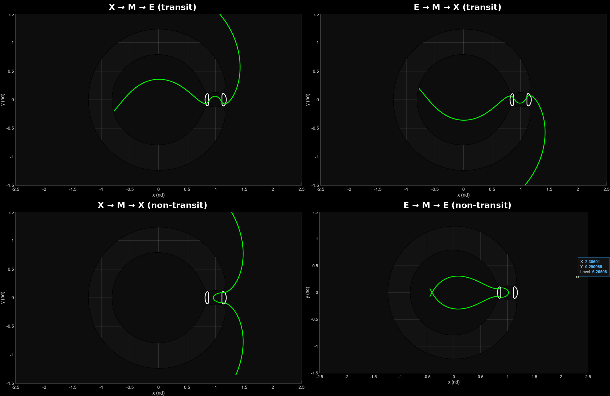
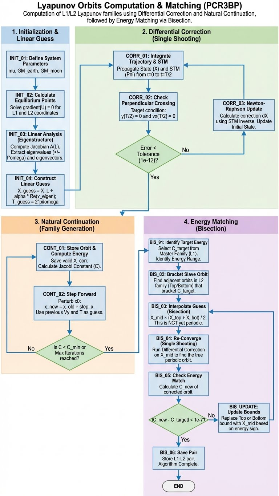
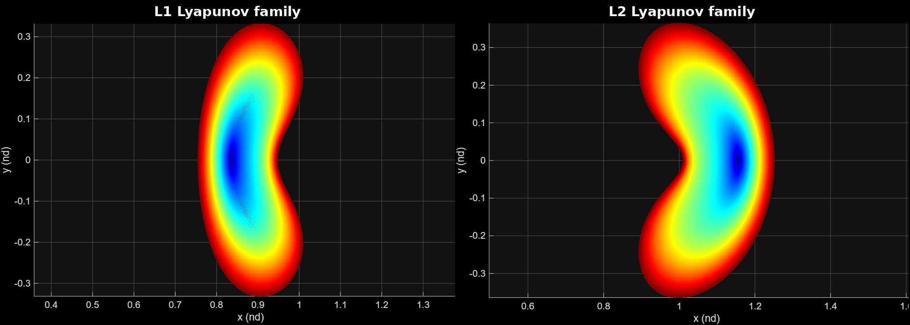
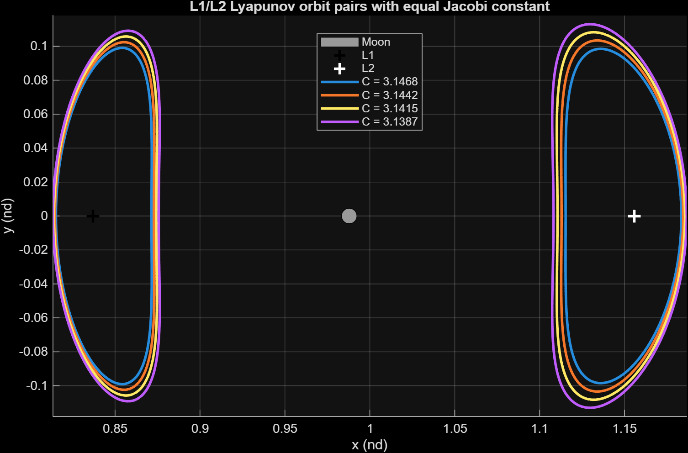
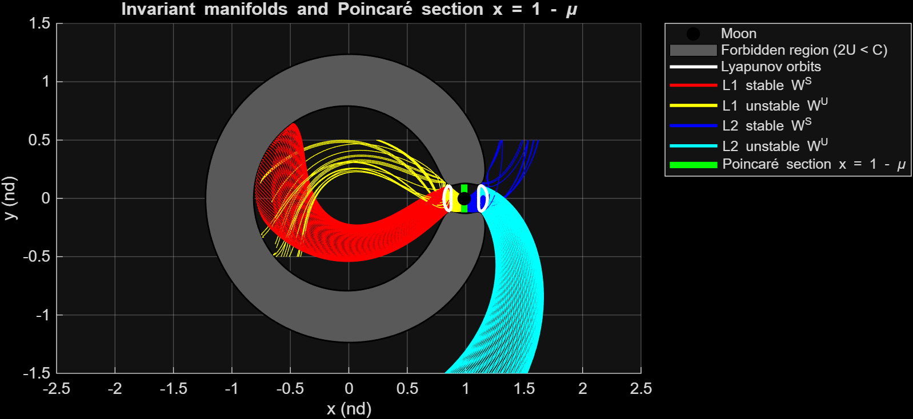
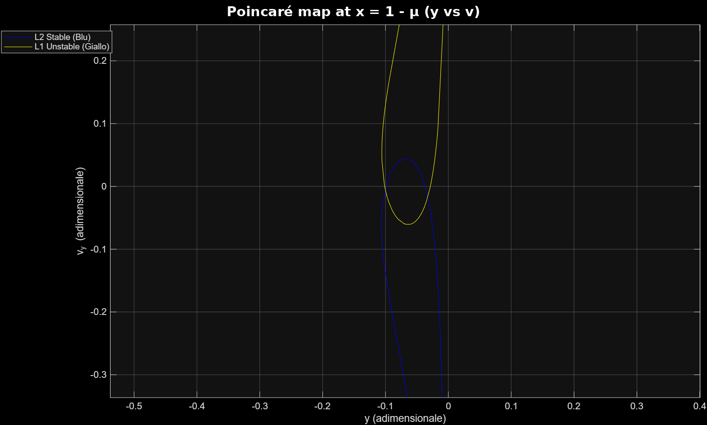

# Lyapunov Orbits and Invariant-Manifold Transfers in the Earth–Moon CR3BP

MATLAB implementation of a complete libration-point mission-analysis workflow in the
**Planar Circular Restricted Three-Body Problem (PCR3BP)**: from the linear analysis
around L1 and L2 to the design of **ballistic (zero-Δv) transfers** that exploit the
stable and unstable manifolds of Lyapunov orbits.



## Highlights

- **Families of periodic orbits**: 139 L1 and 487 L2 planar Lyapunov orbits, computed by
  STM-based single-shooting differential correction (tolerance 10⁻¹², closure error after
  one period ~10⁻¹⁴) and natural-parameter continuation down to C = 2.95.
- **Energy matching**: 4 pairs of L1/L2 orbits with the same Jacobi constant
  (C ≈ 3.139–3.147, bisection tolerance 10⁻⁸), the precondition for a ballistic L1 ↔ L2 connection.
- **Invariant manifolds**: stable and unstable tubes generated from the eigenvectors of the
  monodromy matrix at 100 points per orbit, with a 50 km position-normalised perturbation.
- **Transfer design**: manifold intersections on Poincaré sections give the initial conditions of
  four itineraries through the Earth (E), Moon (M) and Exterior (X) realms.

## Method

| Step | Technique | Output |
|------|-----------|--------|
| 1. Equilibria | Root finding of ∇U = 0 on the x-axis | L1, L2 positions consistent with μ |
| 2. Linear guess | Eigen-analysis of the Jacobian at L1/L2 (saddle × centre) | Initial state and period |
| 3. Differential correction | Newton single shooting on the perpendicular x-axis crossing at T/2, with STM | Periodic orbit |
| 4. Continuation | Natural-parameter continuation in x₀ | L1 and L2 families |
| 5. Energy matching | Bisection on the L2 family, master–slave with L1 | Orbit pairs with equal C |
| 6. Manifolds | Eigenvectors of the local monodromy matrix, forward/backward propagation | W<sup>S</sup>, W<sup>U</sup> tubes |
| 7. Poincaré maps | Intersection of the tubes with the section x = 1 − μ | Connecting states |
| 8. Trajectories | Forward and backward propagation from the selected state | Transit / non-transit itineraries |



The dynamics are written in the synodic frame, in nondimensional units:

$$
\ddot{x} - 2\dot{y} = \frac{\partial U}{\partial x}, \qquad
\ddot{y} + 2\dot{x} = \frac{\partial U}{\partial y}, \qquad
U = \frac{x^2+y^2}{2} + \frac{1-\mu}{r_1} + \frac{\mu}{r_2}
$$

with the Jacobi integral $C = 2U - (\dot{x}^2 + \dot{y}^2)$ and the STM propagated as
$\dot{\Phi} = A(t)\,\Phi$.

## Results

**Lyapunov families and matched pairs**




**Invariant manifolds and Poincaré map** (E → M → X configuration, section at the Moon, x = 1 − μ)




**Initial states of the four itineraries** (pair with C = 3.14148, nondimensional units)

| Itinerary | Type | x | y | u | v |
|-----------|------|---|---|---|---|
| X → M → E | transit | 0.98785 | 0.06 | −0.46377 | 0 |
| E → M → X | transit | 0.98785 | −0.06 | 0.46377 | 0 |
| X → M → X | non-transit | 0.96 | 0 | 0 | −0.82754 |
| E → M → E | non-transit | 1.02 | 0 | 0 | 0.75423 |

The speed is obtained from the Jacobi integral, so every trajectory lies exactly on the energy
level of the selected orbit pair.

## Repository structure

```
├── lyapunov_families.m        # Part 1: linear guess, correction, continuation, energy matching
├── manifold_transfers.m       # Part 2: manifolds, Poincaré maps, transfer trajectories
├── functions/
│   ├── cr3bp_dynamics.m          # equations of motion + STM
│   ├── cr3bp_jacobian.m          # Jacobian of the vector field
│   ├── collinear_points.m        # L1 and L2 positions
│   ├── jacobi_constant.m         # Jacobi integral
│   ├── single_shooting.m         # differential corrector
│   ├── monodromy_eigenvectors.m  # stable/unstable directions
│   ├── event_box.m               # integration stop outside the plot domain
│   └── event_vertical_section.m  # Poincaré section x = const + safety events
├── data/lyapunov_pairs.mat    # matched L1/L2 orbits (output of Part 1)
├── figures/
└── docs/                      # original project reports
```

## How to run

Requires MATLAB R2020a or later, no toolboxes.

1. Run `lyapunov_families.m`. It computes the families and saves `data/lyapunov_pairs.mat`.
   Plotting all the orbits of both families takes a few minutes.
2. Run `manifold_transfers.m`. Set `ITINERARY` to `'XME'`, `'EMX'`, `'XMX'` or `'EME'`
   to choose the trajectory to propagate.

Part 2 can be run on its own, because the matched orbits are already included in `data/`.
Set `SAVE_FIGURES = true` to export the plots to `figures/`.

## References

- W. S. Koon, M. W. Lo, J. E. Marsden, S. D. Ross, *Dynamical Systems, the Three-Body Problem
  and Space Mission Design*, 2011.
- V. Szebehely, *Theory of Orbits: The Restricted Problem of Three Bodies*, Academic Press, 1967.

## Author

**Girolamo Castronovo**, MSc in Space and Astronautical Engineering, Sapienza University of Rome.
Developed for the *Interplanetary Trajectories* course, A.Y. 2025/26.
[LinkedIn](https://www.linkedin.com/in/girolamo-castronovo-286387269/)
